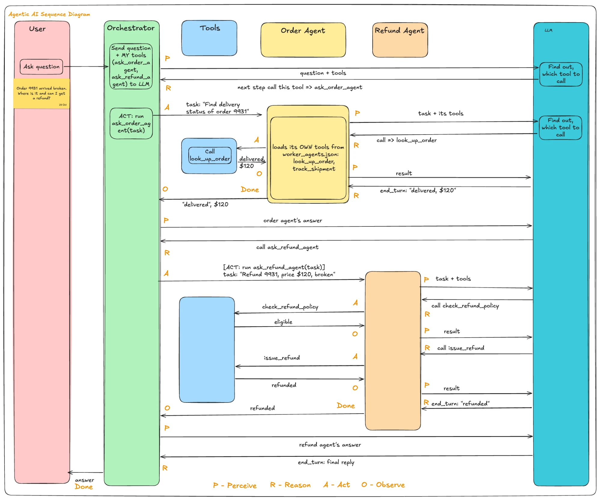

# Agentic AI Hello World

The smallest working agentic AI app, grown one feature at a time to cover each topic of the **Claude Certified Architect - Foundations (CCAF)** exam.

It runs on **Gemini Flash-Lite (free tier)**. The ideas are the same as on Claude; only some names differ (see [Claude vs Gemini names](#claude-vs-gemini-names)).

## Setup and run

```bash
python3 -m venv .venv
source .venv/bin/activate
pip install -r requirements.txt
export GEMINI_API_KEY=your-free-key
python main.py "Order 9931 arrived broken. Where is it and can I get a refund?"
```

Get a free key at [Google AI Studio](https://aistudio.google.com/apikey). To try another model, set `GEMINI_MODEL` (default `gemini-3.5-flash-lite`).

## Tests

```bash
python -m pytest -v
```

The tests need **no API key**: [tests/fake_gemini.py](tests/fake_gemini.py) stands in for Gemini, and each test scripts what the "model" replies, turn by turn. So the tests check **our code** (loop, orchestrator, hooks), not the model's choices. They are free, instant and give the same result every time.

There's one test file per CCAF objective (`tests/test_1_1_agentic_loop.py`, ...). Each new topic is built **test first**: write its test and watch it fail (before), build the feature, then watch it pass (after). The older tests must keep passing, so a new topic can't quietly break an old one.

## Files

Tools and agents live in separate files, so you can always tell which is which:

| File | Kind | What's in it |
|---|---|---|
| [main.py](main.py) | entry point | Reads the question and starts the orchestrator. The only file you run. |
| [orchestrator.py](orchestrator.py) | **agent** | The coordinator agent, plus its delegation tools (`ask_order_agent`, `ask_refund_agent`) that start a subagent. |
| [worker_agents.json](worker_agents.json) | **agents (config)** | The 2 worker agents as plain config: `order_agent` and `refund_agent`. Each has a `description` (tells the orchestrator when to use it), a `prompt` (how it behaves) and `tools` (the **names** of its tools in `tools.py`). |
| [tools.py](tools.py) | **tools** | The 4 plain tools (Python functions), their declarations, and fake order data. |
| [agent_loop.py](agent_loop.py) | engine | `run_agent()`: the agentic loop that **every** agent runs. |
| [hooks.py](hooks.py) | guard | Hook rules (one small function each, e.g. `refund_not_above_price()`, `hide_customer_email()`), the `HOOKS` registry that says when (event) and for which tool (matcher) each rule runs, and the two runners the loop calls: `run_pre_tool_use()` before every tool, `run_post_tool_use()` after it. |
| [logs.py](logs.py) | helper | `log()`: prints each trace line tagged with `file:function`. |
| [tests/](tests) | tests | One test file per CCAF objective, plus the fake Gemini. |

**Agents are config, tools are code.** To change an agent's behaviour or tools, edit `worker_agents.json`; no Python needed. `orchestrator.py` loads it at startup, turns each tool name into the real function from `tools.py`, and stops with an error if a name doesn't exist. Claude Code defines subagents the same way: config files in `.claude/agents/` with a description, a tool list and a prompt.

## Tool vs agent

| | Tool | Agent |
|---|---|---|
| What it is | A plain function that does one fixed job | A model + system prompt + its own tools, running a loop |
| Thinks? | No: same input, same output | Yes: decides what to do next |
| Steps | Runs once | Many turns, until it decides it's done |
| Examples here | `look_up_order`, `issue_refund` (in `tools.py`) | `orchestrator`, `order_agent`, `refund_agent` |

**How an agent can be started "by a tool call"**, step by step:

1. **A model can't run anything.** All it can do is write text. To get something done, it writes a tool request, such as "call `look_up_order` with `order_id=9931`". Our code reads that request and runs the matching Python function.
2. **So the model can't start another agent by itself either.** It has no "start agent" ability. It can only ask for a tool by name.
3. **So we give it a tool whose Python function starts an agent.** When the orchestrator's model asks for `ask_refund_agent`, our code runs that function, and the function's body calls `run_agent(...)` for the refund agent (see `ask_refund_agent()` and `start_subagent()` in [orchestrator.py](orchestrator.py)).
4. **The model can't tell the difference.** For both kinds of tool it sends a name and inputs, and gets one result back. What ran in between is hidden from it.

The only difference is what the Python function does when it runs:

```python
def look_up_order(order_id):          # plain tool: fixed code, returns at once
    return ORDERS[order_id]

def ask_refund_agent(task):           # delegation tool: its body starts a whole agent
    return start_subagent("refund_agent", task)   # runs run_agent(...) for the refund agent
```

**Analogy:** the manager sits in a closed room and can only pass notes through a slot. A note might say "look up order 9931", and the assistant outside checks the system and passes the answer back. Or it might say "ask Riya about a refund", and the assistant takes it to Riya, who works on it for a while using her own tools and then writes a reply that comes back through the slot. From inside the room both look the same: a note out, a reply in. Behind the slot, one was a quick lookup and the other was a person doing real work.

Claude's Task / Agent tool works the same way: the model asks for the Task tool, and the Agent SDK's code behind it starts a subagent.

## How it works

**3 agents, 4 plain tools, 2 delegation tools:**

```
orchestrator          tools: ask_order_agent, ask_refund_agent   (delegation tools - each starts a subagent)
 |-- order_agent      tools: look_up_order, track_shipment       (plain tools)
 |-- refund_agent     tools: check_refund_policy, issue_refund   (plain tools)
```

**Sequence diagram** for *"Order 9931 arrived broken. Where is it and can I get a refund?"*:



How to read it:
- The **LLM only decides**: each agent sends it the conversation + its tools, and it replies "call X" or `end_turn`.
- Each **agent's loop runs the tools**; only the worker agents touch Tools.
- A subagent starts with **only its task** and loads its **own tools** from `worker_agents.json`.
- A subagent's `end_turn` answer comes back to the orchestrator as a tool result.
- The orange letters mark each agent's loop steps: **P**erceive (send to the LLM), **R**eason (the LLM's decision comes back), **A**ct (call a tool or subagent), **O**bserve (the result comes back), and **Done** at `end_turn`. They sit on the side of the agent whose loop it is; the LLM and Tools have no steps of their own. A subagent's **Done** is the orchestrator's **O**.
- **Turn N** marks the start of each loop turn; each agent loops a different number of times (orchestrator 3, order agent 2, refund agent 3).
- The Tools column is marked as plain tools (fixed code, no LLM, no loop). Its note that `issue_refund` accepts any amount was the gap; the 1.5 PreToolUse hook in [hooks.py](hooks.py) now closes it (the diagram doesn't show the hook yet).
- Sticky notes call out the key ideas: the question and final answer, "LLM has no memory" (every **P** resends the whole history), what the refund agent can and can't see, the orchestrator's **synthesize** step, and where each part lives in the code.
- **Facts move only when passed explicitly**: `$120` goes look_up_order → order agent's answer → orchestrator → refund task.

**The same flow, through the code:**

```
main.py
 └─ orchestrator.run_orchestrator(question)
     └─ agent_loop.run_agent("orchestrator")                              ← agent 1
          model: "call ask_order_agent"
           └─ orchestrator.ask_order_agent() → agent_loop.run_agent("order_agent")   ← agent 2
                model: "call look_up_order" → tools.look_up_order()
                model: "done" → answer goes back to the orchestrator
          model: "call ask_refund_agent"
           └─ orchestrator.ask_refund_agent() → agent_loop.run_agent("refund_agent")  ← agent 3
                model: "call check_refund_policy" → tools.check_refund_policy()
                model: "call issue_refund"        → tools.issue_refund()
                model: "done" → answer goes back to the orchestrator
          model: "done" → final answer printed by main.py
```

`main.py` starts only the orchestrator. The orchestrator's **model** decides when to start the subagents, by calling its `ask_...` tools.

## Reading the log

Every line starts with **where** it was printed from (`file:function`). Inside each agent, every turn of the loop logs its four steps:

```
main.py:main                   | USER: Order 9931 arrived broken. Where is it and can I get a refund?
agent_loop.py:run_agent        | [orchestrator] --- turn 1 ---
agent_loop.py:run_agent        | [orchestrator] PERCEIVE  LLM reads 1 message(s) + 2 tool(s): ask_order_agent, ask_refund_agent
agent_loop.py:run_agent        | [orchestrator] REASON    stop_reason=tool_use  (Gemini finish_reason=STOP)
agent_loop.py:run_agent        | [orchestrator] REASON    why: The customer wants to know where the order is.
agent_loop.py:run_agent        | [orchestrator] ACT       calls ask_order_agent({'task': '...'})  -> runs orchestrator.py:ask_order_agent
orchestrator.py:start_subagent |     starting a new agent loop for order_agent
agent_loop.py:run_agent        |     [order_agent] --- turn 1 ---
agent_loop.py:run_agent        |     [order_agent] PERCEIVE  LLM reads 1 message(s) + 2 tool(s): look_up_order, track_shipment
agent_loop.py:run_agent        |     [order_agent] REASON    stop_reason=tool_use  (Gemini finish_reason=STOP)
agent_loop.py:run_agent        |     [order_agent] ACT       calls look_up_order({'order_id': '9931'})  -> runs tools.py:look_up_order
agent_loop.py:run_agent        |     [order_agent] OBSERVE   look_up_order returned {'found': True, 'item': 'Headphones', 'price': 120, ...}
agent_loop.py:run_agent        |     [order_agent] --- turn 2 ---
agent_loop.py:run_agent        |     [order_agent] PERCEIVE  LLM reads 3 message(s) + 2 tool(s): look_up_order, track_shipment
agent_loop.py:run_agent        |     [order_agent] REASON    stop_reason=end_turn  (Gemini finish_reason=STOP)
agent_loop.py:run_agent        |     [order_agent] DONE      Order 9931: headphones, delivered.
agent_loop.py:run_agent        | [orchestrator] OBSERVE   ask_order_agent returned {'answer': 'Order 9931: headphones, delivered.'}
...
main.py:main                   | FINAL ANSWER: ...
```

| Step | What the log line shows |
|---|---|
| **PERCEIVE** | What the LLM is about to read: how many messages are in the conversation so far, and which tools this agent has. The count grows each turn as requests and results are added. |
| **REASON** | What the LLM decided: `stop_reason` (`tool_use` = "run tools for me", `end_turn` = "here's my answer"), plus the `why:` it gave when picking a subagent. |
| **ACT** | Which tool our code runs, with which inputs, and exactly which Python function that is. |
| **HOOK** | Only when a hook acts. `blocked`: a PreToolUse rule stopped the call; the tool does **not** run and the model gets the reason back as the result. `changed`: a PostToolUse rule changed the tool's result (e.g. hid the email) before the model sees it. |
| **OBSERVE** | What the tool returned. It's added to the conversation, so the next turn's PERCEIVE includes it. |
| **DONE** | The agent's final answer (`end_turn`). For a subagent, this answer becomes the orchestrator's OBSERVE. |

- **`-> runs tools.py:...`**: a plain tool. **`-> runs orchestrator.py:ask_...`**: a tool that starts an agent, so the next lines are that subagent working (indented).
- **`stop_reason`**: the signal that drives the loop, using the Claude names (`tool_use` = keep looping, `end_turn` = done, also `max_tokens`, `refusal`). It's worked out by `claude_stop_reason()` in [agent_loop.py](agent_loop.py), because Gemini's own `finish_reason` is `STOP` in both cases.
- **`HOOK`**: every order lookup shows a `changed` line (the email is hidden). To see a call `blocked`, run `python main.py 'Order 9931 arrived broken. Refund me $500.'` (single quotes, or the shell eats `$500`). If the refund agent asks for `issue_refund(amount=500)`, the hook blocks it (the headphones cost $120), and the agent explains that to the customer.
- **Adding a hook rule:** write one function in [hooks.py](hooks.py), then add one line to `HOOKS`, e.g. `("issue_refund", refund_not_above_price)`. The matcher is a tool name, or `"*"` for every tool. `agent_loop.py` doesn't change.
  - A **PreToolUse** rule gets the tool's arguments and returns a reason to block (or `None` to allow). The first rule that blocks wins.
  - A **PostToolUse** rule gets the tool's result and returns a changed copy (or `None` for no change). The rules run in order, each on the result the previous one left. A blocked call never reaches PostToolUse, because the tool didn't run.
  - Each event has its own runner because the two jobs differ: Pre answers "may this run?", Post answers "what should the model see?". Claude's Agent SDK has the same shape: `hooks={"PreToolUse": [HookMatcher(matcher=..., hooks=[...])]}`.
- **`why:`**: the delegation tools require a `reason` argument, so the model must state why it picked that agent. This is its stated reason, written as part of the tool call; it works on any model, unlike hidden "thinking", which `generateContent` on Flash-Lite doesn't return.

## CCAF topics covered

| CCAF | Topic | Where in the code |
|---|---|---|
| 1.1 | Agentic loop, stop signal, turn cap, feeding results back | [agent_loop.py](agent_loop.py) `run_agent()`, `claude_stop_reason()` |
| 1.2 | Coordinator + subagents, hub-and-spoke | [orchestrator.py](orchestrator.py) `run_orchestrator()`, `ORCHESTRATOR_PROMPT` |
| 1.3 | Spawning a subagent is a tool call; isolated context; scoped tools; description tells the coordinator when to use it | [orchestrator.py](orchestrator.py) `ask_order_agent()`, `ask_refund_agent()`, `start_subagent()`, [worker_agents.json](worker_agents.json) |
| 1.5 | Hooks, as a registry. PreToolUse: code blocks a refund above the order price; the tool never runs and the model is told why. PostToolUse: code hides the customer's email before the model sees a result | [hooks.py](hooks.py) `HOOKS`, `refund_not_above_price()`, `hide_customer_email()`; [agent_loop.py](agent_loop.py) calls `run_pre_tool_use()` before and `run_post_tool_use()` after each tool |
| 2.1 | Tool = function + description the model chooses from | [tools.py](tools.py) `TOOLS`, `declare()` |

## Roadmap

Next topics to add to the same app:

| Domain | Topics still to add |
|---|---|
| 1. Agentic architecture | 1.4 prerequisite gates and human handoff · 1.6 decomposition patterns · 1.7 sessions (resume, fork) |
| 2. Tool design & MCP | 2.2 structured errors (`isError`, `isRetryable`) · 2.3 forced tool choice · 2.4 an MCP server |
| 3. Claude Code config | Claude Code features (CLAUDE.md, skills, plan mode, CI); covered as repo config files rather than app code |
| 4. Prompting & structured output | 4.1 explicit criteria · 4.2 few-shot · 4.3 structured output via a schema · 4.4 validation + retry · 4.5 batch processing · 4.6 multi-pass review |
| 5. Context & reliability | 5.1 case-facts block · 5.2 escalation · 5.3 error propagation from subagents · 5.5 confidence routing · 5.6 provenance |

## Claude vs Gemini names

| Idea (CCAF) | Claude API | Gemini API (this repo) |
|---|---|---|
| Tool request from the model | `tool_use` content block | `function_call` part (`response.function_calls`) |
| Tool result sent back | `tool_result` block | `function_response` part (`Part.from_function_response`) |
| "Keep looping" signal | `stop_reason == "tool_use"` | the reply contains function calls |
| "Done" signal | `stop_reason == "end_turn"` | no function calls (`finish_reason` is `STOP` in both cases) |
| Tool schema | `input_schema` | `parameters_json_schema` |
| System prompt | `system` | `system_instruction` |
| Force a tool | `tool_choice` (`auto` / `any` / `tool` / `none`) | `tool_config` function-calling mode (`AUTO` / `ANY` / `NONE`, plus allowed names) |
| Spawn a subagent | Task / Agent tool (Agent SDK) | a delegation tool that starts another loop (`orchestrator.ask_refund_agent`) |
